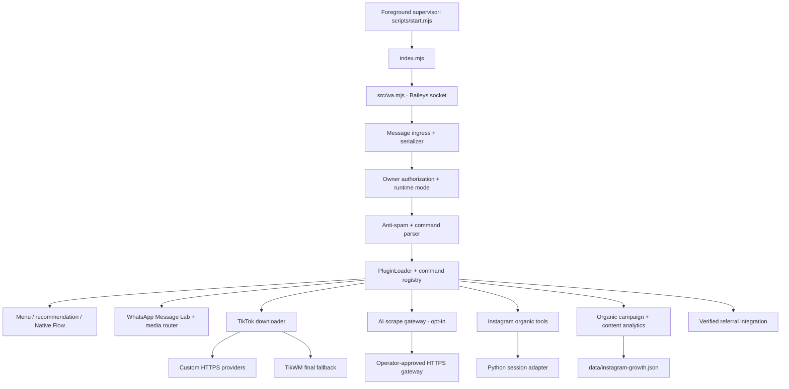

# Architecture — WHISKAY v0.10.25

## Active runtime

`npm start` starts one foreground supervisor and one WhatsApp bot child. The supervisor manages one process lock, forwards shutdown signals, and runs `migrateGrowthState()` against the organic campaign/content allowlist. It does **not** start a Growth order worker, provider worker, Redis worker, or SQLite promotion queue.

## Command and plugin boundary

1. Baileys receives a message and the serializer normalizes wrappers, media descriptors, LID/PN identity, and interactive selections.
2. `src/commands.mjs` parses one command and checks owner authorization, runtime mode, group restrictions, duplicate-message protection, and anti-spam before plugin dispatch.
3. `src/lib/plugin-loader.mjs` loads `.mjs` plugins, keeps a command/alias registry, and supports dependency-aware source snapshots for hot reload.
4. `.menu` keeps the three-action Mixed Native Flow, presents up to ten recommendations separately, and emits the complete command catalogue inline or as bounded text chunks.

## WhatsApp transport

`src/lib/whatsapp-message-router.mjs` owns structured outbound messages: Native Flow, AIRichResponse, table, carousel, Legacy Buttons, ProductMessage, EventMessage, and media. Local media paths are validated and converted into Buffers before Baileys serialization. Transport-specific fallbacks remain separate; a successful send call is not proof of identical rendering across WhatsApp clients.

## TikTok downloader

`src/media/tiktok-scraper.mjs` normalizes public post metadata and media, tries configured custom providers in order, and uses TikWM last. Failover covers both resolve and CDN-download failures. Download headers are allowlisted; Cookie, Authorization, and proxy credentials are not forwarded to CDN hosts. Private/age-restricted responses and access-denied statuses stop fallback rather than bypassing restrictions.

## AI scrape gateway

`src/ai/irfan-scrape-adapter.mjs` is a WHISKAY-owned HTTPS JSON contract, not an implementation of the unverified `irfan-cpp` SDK. It is disabled by default and requires explicit `CONFIRM`, exact-host allowlisting, public-host checks, bounded request/response sizes, and a gateway token stored in environment variables. No voucher/router/lighthouse fields or unrelated chat/session data are sent.

## Organic Growth boundary

`src/growth/store.mjs` persists only allowlisted campaign and content post fields in schema v5. Growth operations remain organic planning, owner-entered Insights, checkpoints, follower funnel calculations, and content analytics. There is no internal balance, wallet, credit, ledger, order, budget, payment, SMM provider delivery, Redis queue, or SQLite worker.

Legacy `data/growth-queue.sqlite` files are not opened by the current runtime and are not automatically deleted by source upgrades. Back them up outside the project before deciding whether to remove them. Historical queue runbooks are archived and must not be followed as active runtime instructions.

## Configuration, secrets, and test state

- `config/app.example.json` is the shareable non-secret template; `config/app.json` is local operator state and is excluded from source ZIPs.
- `.env` stores tokens/passwords and is excluded from source ZIPs. `.env.example` lists variable names and safe defaults only.
- `session/`, `auth_ig/`, and `data/` are private runtime directories and are excluded from releases.
- When Node Test Runner sets `NODE_TEST_CONTEXT`, private-state paths redirect to a disposable per-process temporary directory.

## Limitations

Automated tests use fixtures and mocked network adapters. They do not prove WhatsApp live rendering, TikTok provider uptime, TikWM availability, AI gateway response quality, Instagram session acceptance, or any follower-growth outcome.
