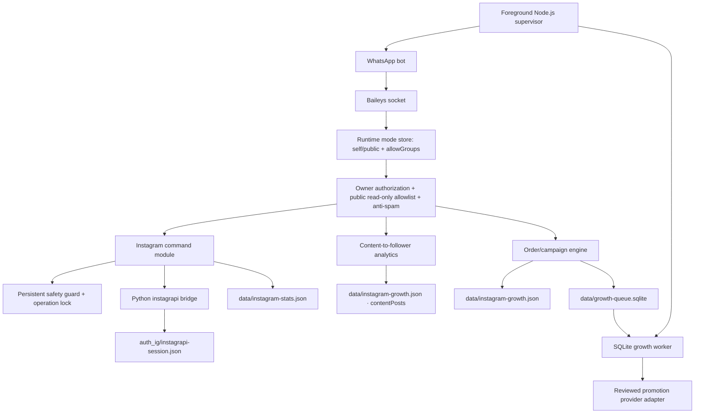

# Architecture — v0.10.7

## Configuration root

`src/config.mjs` derives `PROJECT_ROOT` from its module location. Relative paths in `config/app.json` are anchored there, avoiding path drift when a command is launched with a different current working directory. Secret values remain in `.env`; ordinary settings remain in JSON.

## Instagram lifecycle

1. Startup inspects the local Python adapter and session file only; it does not send requests to Instagram.
2. `.igcheck` distinguishes missing username, unavailable Python, missing/unsafe session, and a locally present but unverified session.
3. `.igprofile` and `.igsync` load the existing settings lazily using `Client.load_settings()`.
4. `.iglogin` is allowed only when the configured session path is absent and no safety hold/cooldown blocks it.
5. Python validates the returned profile before persisting settings to a private temporary file and atomically replacing the session path.
6. Persistent guard state enforces login cooldown, profile cache/cooldown, sync cooldown, safety hold, and an exclusive cross-process operation lock.

The local session file status is not a remote authentication guarantee. Actual session acceptance is only known when an Instagram request is made.

## Test-state isolation

When Node Test Runner sets `NODE_TEST_CONTEXT`, `src/config.mjs` maps all private state locations to a per-process directory under the OS temporary directory. This includes WhatsApp session directory, Instagram session/settings, statistics, safety guard, order/ledger DB, SQLite queue, runtime-mode state, and LID map. The test worker removes its temporary state on exit. Production execution does not use this branch.

This is essential because v0.9.3 test files had top-level `rm()` calls against the configured project files. In v0.9.4 the tests are isolated and refuse direct execution outside Node Test Runner.

## Growth subsystem

Order and ledger data remain local JSON behind a cross-process lock and atomic file replacement. Durable work items use Node.js built-in `node:sqlite` with transactional claim, idempotent job IDs, bounded retry, and stale-job recovery. Provider integration remains disabled by default and requires owner approval. Service metadata filtering checks multiple upstream catalog fields, not name alone. Queue errors are sanitized before persistence/logging, terminal history is bounded to 1,000 completed and 1,000 failed rows, and `getQueueStats()` exposes job age/due-time metrics without exposing job payload. This is a single-host design; multi-host operation requires a transactional shared database.

## WhatsApp runtime

Baileys socket lifecycle, LID↔PN mapping, owner authorization, message ingress, anti-spam, plugin loading, and graceful shutdown remain in JavaScript. WhatsApp key state is not migrated into or reused as Instagram settings.

## Runtime modes and group isolation — v0.10.9

`src/lib/runtime-mode.mjs` supplies durable access policy to `src/commands.mjs`. In `self`, owner authorization remains mandatory and group use is conditional on `allowGroups`. In `public`, groups are unconditionally rejected and only the private-chat informational allowlist is accepted. `.mode` is a built-in owner-only command and changes the JSON state atomically.

## Content intelligence — v0.10.9

`src/growth/content-intelligence.mjs` is a pure calculation module. `src/growth/store.mjs` persists unique Instagram content URLs and up to 90 snapshots each in the `contentPosts` collection. `src/plugins/instagram-growth.mjs` exposes `.igcontent`; all values are manually entered from per-content Insights. Weighted format/theme aggregations are computed from summed counts, not from a simple average of percentages. The store version changes from v2 to v3; v1/v2 records are preserved while `contentPosts` is initialized as an empty array.
